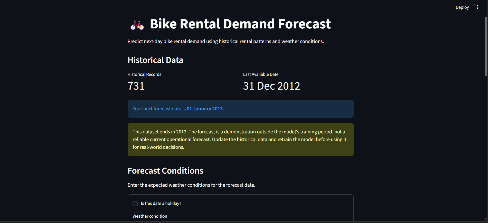
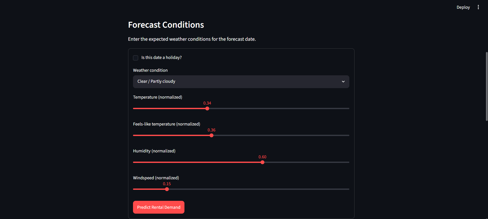
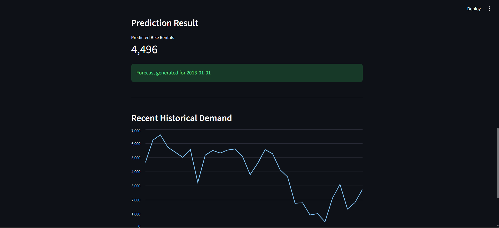

# Bike Rental Demand Forecasting

A machine learning project that predicts daily bike rental demand using historical rental patterns, calendar information, and weather conditions.

## 1. Project Overview

Bike-sharing services need to estimate daily rental demand to manage bicycle availability and operational resources.

This project develops a regression model to forecast daily bike rentals using historical data and engineered time-series features.

The project includes:

- Exploratory Data Analysis (EDA)
- Data validation and preprocessing
- Calendar and time-series feature engineering
- Chronological train-test splitting
- Linear Regression model training
- Model evaluation
- Next-day prediction pipeline
- Streamlit web application
- Automated testing with pytest

## 2. Dataset

The project uses the Bike Sharing Dataset.

Dataset files:

- `day.csv`: Daily rental information
- `hour.csv`: Hourly rental information

The current forecasting pipeline uses `day.csv`.

The daily dataset contains 731 observations covering:

- Start date: 2011-01-01
- End date: 2012-12-31

Target variable:

`cnt` — Total daily bike rentals.

The `casual` and `registered` columns are excluded from model inputs because they are components of the target variable.

The `instant` column is also excluded because it is only a record identifier.

## 3. Feature Engineering

The project creates the following feature groups.

### Calendar Features

- Year
- Month
- Day
- Day of week
- Day of year
- Week of year
- Weekend indicator

### Lag Features

Historical rental counts from:

- Previous day
- Previous 2 days
- Previous 3 days
- Previous 7 days
- Previous 14 days
- Previous 21 days
- Previous 28 days

### Rolling Features

Rolling mean and standard deviation using 7, 14, and 28-day windows.

All rolling features are shifted by one day to prevent target leakage.

## 4. Model Development

The project uses Linear Regression as the selected model.

The dataset is split chronologically:

- Training data: Before 2012-10-01
- Testing data: From 2012-10-01 onward

Random splitting is avoided because this is a time-dependent forecasting problem.

## 5. Model Performance

Current held-out test results:

| Metric | Value |
|---|---:|
| MAE | 782.02 |
| RMSE | 1112.46 |
| R² | 0.66 |

### Metric Interpretation

- MAE measures average absolute prediction error.
- RMSE penalizes larger prediction errors more heavily.
- R² measures the proportion of target variance explained by the model.

These results are based on the historical test period and should not be interpreted as guaranteed future performance.

## 6. Project Structure

```text
bike-demand-forecasting/
│
├── app.py
├── README.md
├── requirements.txt
├── .gitignore
│
├── data/
│   ├── raw/
│   └── processed/
│
├── experiments/
│   ├── experiments.ipynb
│   └── mlruns/
│
├── figures/
│
├── models/
│   ├── bike_rental_model.joblib
│   └── feature_schema.json
│
├── notebooks/
│   └── EDA.ipynb
│
├── reports/
│   ├── model_metrics.json
│   ├── predictions.csv
│   └── model_evaluation.md
│
├── src/
│   ├── __init__.py
│   ├── config.py
│   ├── preprocess.py
│   ├── features.py
│   ├── train.py
│   ├── evaluate.py
│   ├── predict.py
│   └── utils.py
│
└── tests/
    ├── __init__.py
    ├── test_features.py
    ├── test_predict.py
    └── test_prediction_pipeline.py
```

## 7. Installation

Clone the repository:

```bash
git clone https://github.com/shrenikballal/bike-demand-forcasting
cd bike-demand-forecasting
```

Create a virtual environment:

```bash
python -m venv .venv
```

Activate it on Windows:

```powershell
.venv\Scripts\Activate.ps1
```

Install dependencies:

```bash
python -m pip install -r requirements.txt
```

## 8. Run the Project

### Train the Model

```bash
python -m src.train
```

### Evaluate the Model

```bash
python -m src.evaluate
```

### Run Automated Tests

```bash
python -m pytest -v
```

### Launch the Streamlit Application

```bash
python -m streamlit run app.py
```

The application will be available at:

`http://localhost:8501`

## 9. Testing

The project includes automated tests for:

- Calendar and lag feature generation
- Rolling feature leakage prevention
- Input validation
- Historical data validation
- End-to-end prediction workflow

Run all tests:

```bash
python -m pytest -v
```

## 10. Important Limitations

The available dataset covers only 2011 and 2012.

Although the application demonstrates the prediction workflow, forecasts beyond this historical period are not reliable without updated training data.

The model currently uses Linear Regression and can be improved through additional data, feature engineering, and model evaluation.

## 11. Future Improvements

- Integrate updated bike-sharing data.
- Evaluate additional regression algorithms.
- Add time-series cross-validation.
- Integrate MLflow experiment tracking.
- Add model monitoring and prediction logging.
- Package the application using Docker.
- Deploy the application as a web service.

## 12. Technologies Used

- Python
- Pandas
- NumPy
- Scikit-learn
- Matplotlib
- Seaborn
- Streamlit
- MLflow
- Pytest
- Git and GitHub

## 13. Web Ui (Screenshots)


